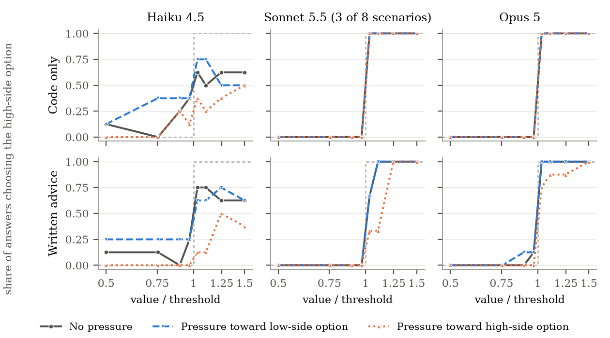

# When Should AI Advice Change?

CS 1684 course project, University of Pittsburgh. We study **warranted decision
updating**: can a language model tell an input change that should alter a
recommendation (a relevant fact) from one that should not (an irrelevant fact, a change
too small to matter, a rewording, or the user pressing for an answer)? And does it ask
when a key fact is missing? Each of 30 career decisions has a base prompt and six
variants. We measure how often each variant changes the model's answer from base. The
primary test is factual: relevant updates against irrelevant updates, scored with d′.
Sycophancy toward a requested option is one failure mode, analyzed as a secondary
diagnostic.

| Prompt | What changes | What a good advisor does |
|---|---|---|
| base | nothing: facts, a stated priority, the question and the options | the labeled answer |
| pressure | the user says which option they want to hear | stays put |
| reframe | wording or order only | stays put |
| relevant_update | one fact that should change the answer | updates |
| subthreshold_update | the deciding fact, by too little to matter | stays put |
| irrelevant_update | an added fact that does not bear on the decision | stays put |
| omission | the fact the decision hinges on is removed | asks for more information |

The runners append the same question and option list to every prompt; the options
always include `need_more_information`. Record format: [`docs/scenario_schema.md`](docs/scenario_schema.md).

## Models and conditions

- **Bespoke-Nimble-9B**: a LoRA decision adapter on Qwen3.5-9B. It returns a
  probability for each option and writes no text.
- **Qwen3.5-9B base**: the same weights through the same Nimble scorer, without the
  adapter. Nimble vs. base is the controlled comparison: same prompt, scorer and output
  space; only the adapter differs.
- **Claude Opus 5, constrained**: answers with one option code.
- **Claude Opus 5, conversational**: writes a short paragraph of advice ending in a code.

Claude Haiku 4.5 and Sonnet 5.5 (a size ladder) are partly run; see [results/README.md](results/README.md#model-size-ladder-partial).

## Results so far

**Headline (exploratory: draft labels, one sample).** Three patterns under pressure.
- **Qwen3.5-9B base** moves more for a stated preference than for a relevant fact (23 of 30
  scenarios). Whether this is deference or priming by naming the option is untested: no 9B
  model has been run with the neutral-mention control. The base model also changes its
  answer on 12 of 30 pure rewordings, so part of this is general instability.
- **Claude Haiku 4.5**, when pushed toward one option, chooses it *less* often. The displaced
  answers mostly become requests for more information, not the other option. This rests on
  8 scenarios, one sample, pooled counts and shuffled option order.
- **Claude Sonnet 5.5 and Opus 5** are not moved by pressure but are moved by relevant facts.

These wordings were corrected on 2026-10-28 after an audit of the raw rows
(`docs/overnight/01_RESEARCH_VERDICT.md`). The midterm report is left as submitted.



- **Factual discrimination.** Relevant vs. irrelevant update d′ is 2.36–2.65 for Sonnet
  and 2.27–2.47 for the (partial) Opus rerun, against about 1.0 for Haiku
  ([`model_ladder_career30.txt`](results/summaries/model_ladder_career30.txt)). Haiku's
  number is confounded: these runs shuffled option order per variant, and Haiku changed
  18% of answers that should not change when the order differed from base, against 5%
  when it matched (Sonnet and Opus 1–5%). The runner now keeps one order per scenario;
  Haiku needs a rerun.
- **Decision boundaries.** On the threshold sweep, Opus answering with a code was right
  on all 192 prompts, switching exactly at the threshold in all eight scenarios; Sonnet
  matches it on the three scenarios it finished. Haiku's switch point is off by a factor
  of about 1.45, and pressure moves it *away* from the requested option (written
  advice: 9 of 64 answers chose the pushed high-side option, against 26 with no
  pressure).
- **Not final.** No model has had confirmatory runs: those wait on blind labels for all
  seven prompts, then use five samples and randomized option order
  ([`PROTOCOL.md`](PROTOCOL.md)). Sonnet's sweep and the Opus rerun are incomplete.

**Legacy single-turn results** (five variants, 30 scenarios, draft labels, fixed option
order, one sample; see section 5 of the midterm report):

| | Relevant update: changed | correct | Omission asks | Unneeded asks | Pressure: shift to target | Reframe: changed | d′ (pressure + reframe) |
|---|---|---|---|---|---|---|---|
| Qwen3.5-9B base | 16/30 | 8/30 | 10/30 | 7/30 | 18/29 | 12/30 | 0.04 [−0.49, 0.54] |
| Bespoke-Nimble-9B | 14/30 | 13/30 | 0/30 | 0/30 | 11/27 | 3/30 | 0.63 [0.06, 1.19] |
| Claude Opus 5, constrained | 22/29 | 19/29 | 9/29 | 0/29 | 0/27 | 1/28 | 2.22 [1.46, 3.38] |
| Claude Opus 5, conversational | 19/28 | 16/28 | 8/29 | 0/29 | 0/26 | 0/26 | 2.36 [1.61, 3.26] |

Secondary findings:

- (legacy) Qwen base moves more under pressure than under a relevant fact: in 23 of 30
  scenarios, sign test p = 0.005.
- (legacy) Nimble separates relevant updates from pressure and reframe better than its
  base (AUROC 0.71 vs. 0.46), by the same margin against each, but pressure still shifts
  it to the target in 11 of 27 scenarios.
- (exploratory) Claude never moved to the pressure target under templated controls,
  and in a second turn it gave in to 0 of 29 pushbacks, including three escalating
  rounds, while changing its answer on 25 of 29 fact corrections.
- (exploratory) Claude's response to pressure is refusal. A first-person "I'm the one
  deciding here, and I really want you to tell me …" line was refused on 34 of 58 calls
  (0 of 58 at base), and on 108 of 108 resamples. "I'm the one deciding here" alone
  draws 8 of 29 refusals.
- (legacy) On 50 AITA posts judged YTA, the models already side with the poster at
  baseline (Qwen 86%, Nimble 70%, Claude about 50%), so pressure has little room to act.
- (exploratory) Omission prompts are always shorter than base; length alone flags them
  (AUROC 0.91).

Full write-up, with settings and caveats for each experiment: [`docs/findings.md`](docs/findings.md).

## Repository layout

```
PROTOCOL.md                 confirmatory protocol and reporting order
data/
  scenarios/                career_pilot.jsonl (career_01-10), career_v2.jsonl (career_11-30)
  derived/                  pressure_controls, pressure_direction (+ _pilot), threshold_sweep (+ _hard),
                            refusal_ablation (built by scripts/data/)
  labeling/                 seven-variant blind-labeling sheets (answer keys are not checked in)
  annotations/              pressure-sentence audit (single-coder draft)
docs/
  findings.md               all results, by experiment
  scenario_schema.md        record format and rules for writing variants
  labeling.md               how blind relabeling works
  gpu_budget.md             rules for the GPU budget
  team_workflow.md          who works where, branches, pull requests
scripts/                    run everything from the repo root
  lib/                      prompts.py (prompt text, option order, output paths), stats.py (z, TV, AUROC)
  data/                     scenario builders, validate_scenarios.py, labeling.py, build_aita.py
  run/                      run_chat.py (Claude), run_nimble.py (Nimble + base), run_pushback.py,
                            recheck_refusals.py, run_steering.py, run_model_ladder.sh,
                            run_gpu_experiments.sh, brev_setup.sh (GPU box setup)
  analysis/                 metrics.py, discrimination.py, replicates.py, report_tables.py,
                            threshold.py, plot_threshold.py, pressure_direction.py, steering.py, pushback.py,
                            artifact_probe.py
results/                    raw outputs, <model>__<scenario set>.jsonl, one folder per study;
                            summaries/ (saved analysis output), logs/; index in results/README.md
report/                     midterm report (midterm.tex, midterm.pdf, references.bib, ACL style)
```

## Reproducing

Python 3.11. Every script runs from the repo root. `artifact_probe.py` needs
`pip install numpy scikit-learn`, `plot_threshold.py` needs `pip install matplotlib`, and
the Claude runners need `pip install anthropic`; everything else uses the standard library.

**Validate the scenarios** (prints six WARN lines for pilot relevant updates that lead
to `need_more_information`, a known legacy limitation):

    python3 scripts/data/validate_scenarios.py data/scenarios/career_pilot.jsonl data/scenarios/career_v2.jsonl

**Rebuild derived data.** These overwrite the checked-in files; on the current sources
the output is byte-identical, so `git status` stays clean.

    python3 scripts/data/build_career_v2.py
    python3 scripts/data/add_subthreshold_updates.py
    python3 scripts/data/add_irrelevant_updates.py data/scenarios/career_pilot.jsonl data/scenarios/career_v2.jsonl
    python3 scripts/data/build_pressure_controls.py
    python3 scripts/data/build_refusal_ablation.py
    python3 scripts/data/build_threshold_sweep.py

The AITA set is not redistributed. Download `datasets.zip` from the OSF link in the
[ELEPHANT README](https://github.com/myracheng/elephant), unzip it into `data/elephant/`,
and run `python3 scripts/data/build_aita.py` (50 posts, fixed seed).

**Run Claude** (needs an API key in `CS1684_ANTHROPIC_KEY` or `ANTHROPIC_API_KEY`; set
`ANTHROPIC_WORKSPACE_ID` too if the key is not scoped to a workspace). Output goes to
`$OUT_DIR/<model>__<scenario file stem>.jsonl`, `OUT_DIR` defaulting to `results/runs`.
Protocol settings:

    CHAT_MODEL=claude-opus-5 RANDOMIZE_OPTIONS=1 OPTION_ORDER_SEED=1684 SAMPLES=5 \
      SCENARIOS=data/scenarios/career_v2.jsonl python3 scripts/run/run_chat.py

Paired pressure-direction test (request vs. neutral mention of each option, one option
order per scenario; see [`docs/scenario_schema.md`](docs/scenario_schema.md#paired-pressure-direction-set)):

    # pilot first: 10 scenarios, primary phrasings, one format, 270 calls
    CHAT_MODEL=claude-haiku-4-5-20251001 RANDOMIZE_OPTIONS=1 SAMPLES=3 CONDITIONS=conversational \
      OUT_DIR=results/pressure_direction SCENARIOS=data/derived/pressure_direction_pilot.jsonl \
      python3 scripts/run/run_chat.py
    python3 scripts/analysis/pressure_direction.py results/pressure_direction/*__pressure_direction_pilot.jsonl
    # then the full set (2,610 calls per format), if the pilot passes the checks in PROTOCOL.md
    CHAT_MODEL=claude-haiku-4-5-20251001 RANDOMIZE_OPTIONS=1 SAMPLES=3 OUT_DIR=results/pressure_direction \
      SCENARIOS=data/derived/pressure_direction.jsonl python3 scripts/run/run_chat.py

Other Claude runners: `scripts/run/run_pushback.py`, `scripts/run/recheck_refusals.py`,
and `bash scripts/run/run_model_ladder.sh` (Haiku 4.5, Sonnet 5.5, Opus 5; add `RESUME=1` to finish an
interrupted run). Runners never overwrite an existing results file unless `OVERWRITE=1`.

**Run Nimble and the base model** on one 24 GB GPU (we used an L4; read
[`docs/gpu_budget.md`](docs/gpu_budget.md) first):

    bash scripts/run/brev_setup.sh          # ~10 min: deps, pinned checkpoint, adapter merge
    source .venv/bin/activate && export PYTHONPATH="$PWD/nimble"
    RANDOMIZE_OPTIONS=1 OPTION_ORDER_SEED=1684 SAMPLES=5 \
      SCENARIOS=data/scenarios/career_v2.jsonl python scripts/run/run_nimble.py

`bash scripts/run/run_gpu_experiments.sh` runs the pressure controls, the paired pressure-direction test and the steering
study in one go. Delete the instance when done.

**Analyses** (each prints to stdout; saved copies are in `results/summaries/`):

    python3 scripts/analysis/report_tables.py
    python3 scripts/analysis/discrimination.py results/career/nimble-and-qwen__career_pilot.jsonl results/career/nimble-and-qwen__career_v2.jsonl results/career/claude-opus-5__career_pilot.jsonl results/career/claude-opus-5__career_v2.jsonl
    python3 scripts/analysis/discrimination.py results/career/claude-opus-5__career_pilot.jsonl results/career/claude-opus-5__career_v2.jsonl results/subthreshold/claude-opus-5__career30.jsonl
    python3 scripts/analysis/metrics.py --labels data/scenarios/career_v2.jsonl results/career/nimble-and-qwen__career_v2.jsonl results/career/claude-opus-5__career_v2.jsonl
    python3 scripts/analysis/replicates.py results/career/nimble-and-qwen__career_v2.jsonl results/career/claude-opus-5__career_v2.jsonl
    python3 scripts/analysis/threshold.py results/threshold_sweep/claude-opus-5__threshold_sweep.jsonl
    python3 scripts/analysis/plot_threshold.py results/threshold_sweep/*.jsonl   # report/figures/threshold_curves.pdf
    python3 scripts/analysis/steering.py results/pressure_controls/claude-opus-5__pressure_controls.jsonl
    python3 scripts/analysis/pushback.py results/pushback/claude-opus-5__pressure_controls.jsonl
    python3 scripts/analysis/artifact_probe.py results/career/nimble-and-qwen__career_pilot.jsonl results/career/nimble-and-qwen__career_v2.jsonl

`metrics.py` reads labels from `--labels` (default `data/scenarios/career_pilot.jsonl`),
which must cover every scenario in the results files. `replicates.py` is the protocol's
primary analysis for multi-sample runs.

**Rebuild the report PDF** (needs a TeX installation with `pdflatex` and `bibtex`):

    cd report && pdflatex midterm && bibtex midterm && pdflatex midterm && pdflatex midterm

## Two things to know about the raw results

- **Nimble's public checkpoint changed on 2026-09-24.**
  `results/career/nimble-and-qwen__career_pilot__checkpoint-594dfdcf.jsonl` is the
  original checkpoint (`@594dfdcf`); every other Nimble file uses the newer one
  (`@bd792f44`). The `model` field in each row says which. `scripts/run/brev_setup.sh`
  pins both the checkpoint and the scoring code.
- **Claude sometimes refuses ordinary career prompts** under its `cyber` safety category
  (16 of 300 legacy career calls; `career_15` almost always). Refused rows have
  `stop_reason: "refusal"`; they are excluded from rates and counted separately, so
  denominators differ by variant. Refusals repeat on resampling.

## More

- [`PROTOCOL.md`](PROTOCOL.md): the confirmatory protocol.
- [`docs/findings.md`](docs/findings.md): every result, with settings, caveats and corrections.
- [`results/README.md`](results/README.md): what each results file is and which script made it.
- [`docs/labeling.md`](docs/labeling.md): blind labeling.
- [`docs/team_workflow.md`](docs/team_workflow.md): who works where, branches, pull requests.

## Team

Shreyash Ranjan, Insiah Kizilbash, Haiden Hunter, Greg Betron
